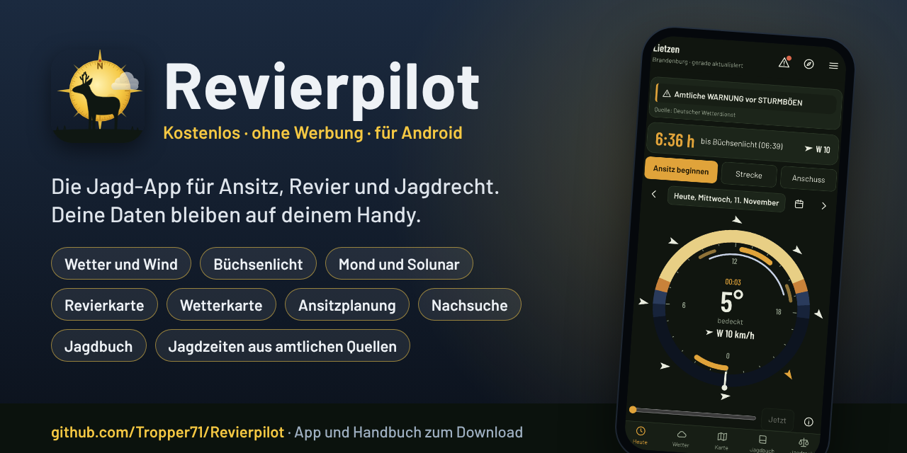

<p align="center"></p>

# Revierblick

**Die kostenlose Jagd-App für Android.** Wetter und Wind, Büchsenlicht, Mond und Solunar, Satellit, Radar und Wetterfilm, Revierkarte mit Ständen, Entfernungs- und Flächenmessung, Standwahl nach Wind, Auto-Standort mit Rückführung, Anschussmeldung an den Schweißhundeführer, Jagdbuch und Jagdzeiten aller Bundesländer in einer App. Ohne Werbung, ohne Konto, alle Revierdaten bleiben auf deinem Handy.

| | |
|---|---|
| **Aktuelle Version** | 2.6.0 vom 15.11.2026 |
| **Android** | 7.0 oder neuer |
| **Rechtsdaten** | Fassung 2026-11-10.3, wöchentlich gegen amtliche Quellen geprüft |
| **Handbuch** | 42 Seiten, passend zu Version 2.6.0 |

## Herunterladen

| Datei | Download |
|---|---|
| App, Version 2.6.0 (Android 7.0 oder neuer) | [Revierblick-2.6.0.apk](https://raw.githubusercontent.com/Tropper71/Revierblick/main/app/Revierblick-2.6.0.apk) |
| Handbuch (PDF, 42 Seiten) | [Revierblick-Handbuch.pdf](https://raw.githubusercontent.com/Tropper71/Revierblick/main/docs/Revierblick-Handbuch.pdf) |

### So installierst du die App
1. Den Link oben auf dem Handy antippen und die APK herunterladen.
2. Die Datei öffnen. Beim ersten Mal fragt Android, ob Apps aus dieser Quelle installiert werden dürfen: einmal erlauben.
3. Warnt Google Play Protect, *Trotzdem installieren* wählen. Das ist bei Apps außerhalb des Play Stores normal.
4. Tipp: In den Android-Einstellungen die Akku-Optimierung für Revierblick auf *Nicht eingeschränkt* stellen, damit Meldungen pünktlich kommen.

**Update:** Neue Versionen einfach über die alte installieren, alle Daten bleiben erhalten. Das gilt auch beim Wechsel von Revierkompass, Revierbuch oder Revierwetter. Ausführliche Anleitung im Handbuch, Kapitel 2.

**Jagdrecht:** Die Jagdzeiten werden wöchentlich gegen die amtlichen Quellen geprüft. Die App meldet neue Fassungen und übernimmt sie erst nach deiner Bestätigung.

> Keine Rechtsberatung. Maßgeblich sind die amtlich verkündeten Vorschriften und die Anordnungen deiner Jagdbehörde.

## Neu in Version 2.6.0: Anschuss an den Schweißhundeführer melden

Mit **Melden** an einer offenen Nachsuche gehen alle Angaben zum Anschuss per WhatsApp, SMS oder E-Mail an den hinterlegten Schweißhundeführer:

- **Nachricht automatisch erstellt:** Wildart, Schusszeit, Stand und Revier, Schussentfernung, Reaktion, Fluchtrichtung, Pirschzeichen, laufende Wartezeit, Koordinaten des Anschusses mit Kartenlink und Notiz. Der Text lässt sich vor dem Senden ändern
- **Treffpunkt:** auf Wunsch der gespeicherte Auto-Standort mit Kartenlink
- **Absender für Rückfragen** wird gespeichert und mitgeschickt
- **Versand:** WhatsApp, SMS oder E-Mail öffnen sich mit Empfänger und Text, über *Andere App* geht es auch an Signal oder eine Gruppe. Abgeschickt wird in der jeweiligen App
- Wird beim Erfassen eines neuen Anschusses ein Schweißhundeführer gewählt, öffnet sich die Meldung nach dem Speichern von selbst
- Schweißhundeführer haben jetzt auch eine E-Mail-Adresse und lassen sich bearbeiten
- Auf der Nachsuche steht danach, an wen, auf welchem Weg und wann gemeldet wurde

## Seit Version 2.5.0: Wetterkarte mit Satellit, Radar und Wetterfilm

Der neue Reiter **Wetterkarte** auf der Wetterseite zeigt das Wetter großräumig um deinen Standort und lässt es als Film ablaufen:

- **Satellit und Radar:** Wolkenbild von Meteosat (EUMETSAT) in Echtfarben oder als Infrarotbild, das auch nachts funktioniert, darüber das Niederschlagsradar des DWD. Der Film läuft von 2 Stunden zurück bis 2 Stunden voraus, der vordere Teil ist die Radarvorhersage des DWD
- **Vorhersage 48 h:** Wolken, Niederschlag, Wind und Temperatur Stunde für Stunde, einzeln zuschaltbar
- **Film:** Abspielen und Anhalten, Einzelschritte, Zeitregler und drei Geschwindigkeiten. Zur Uhrzeit steht der Abstand zu jetzt
- Standort und Reviergrenzen sind eingezeichnet, beim Verschieben der Karte lässt sich die Vorhersage für den neuen Ausschnitt laden

Die Vorhersage beruht auf 81 Punkten im Abstand von etwa 30 km. Sie zeigt, wie Fronten und Regengebiete ziehen. Für das Revier selbst gilt die Stundenvorhersage auf der Wetterseite.

## Seit Version 2.4.0: Entfernung und Fläche messen

Das **Lineal** in der Kartenleiste startet das Messwerkzeug direkt auf der Karte:

- **Strecke:** Punkte antippen, angezeigt werden Gesamtlänge, letzte Teilstrecke und Richtung. Jede Teilstrecke und die Summe stehen auch auf der Karte
- **Vom Standort:** Startpunkt ist die eigene GPS-Position. Ein Tipp auf das Ziel zeigt Entfernung und Richtung
- **Fläche:** Eckpunkte antippen, angezeigt werden Fläche in m² oder ha und Umfang, etwa für Wildschäden oder Wildäcker
- **Ab einem Stand:** Im Fenster einer Einrichtung startet *Messen* mit dem Stand als Startpunkt, zum Beispiel für Schussentfernungen zu Wechseln und Kirrungen
- Zurück, Neu und Fertig; ein Tipp auf eine Einrichtung setzt den Punkt genau auf deren Position

## Seit Version 2.3.0: Auto-Standort und Weg zum Auto

Vor dem Ansitz oder bevor du als Treiber oder Schütze zur Drückjagd aufbrichst, merkst du dir mit einem Tipp, wo das Auto steht. Nach der Jagd führt dich die App auf direktem Weg zurück.

- **Auto-Standort merken:** auf der Startseite, als Auto-Symbol in der Kartenleiste, im Plus-Menü der Karte und bei jeder Drückjagd
- **Genaue Messung:** bis zu 15 Sekunden GPS, der genaueste Wert wird gespeichert, mit Anzeige der Genauigkeit. Ohne Empfang lässt sich das Auto auf der Karte setzen
- **Zum Auto:** Pfeil in Richtung Auto (dreht sich mit dem Kompass des Handys), Entfernung in Luftlinie, Himmelsrichtung mit Gradzahl und geschätzte Gehzeit, laufend aktualisiert. Bei weniger als 15 m meldet die App *Am Auto*
- **Auf der Karte:** Auto-Symbol, eigene Position und Luftlinie mit Entfernung. Auf Wunsch Übergabe an eine andere Karten-App
- Der Bildschirm bleibt während der Führung an

Außerdem behoben: Stand der Wind während des ganzen Ansitzfensters seitlich zu einem Stand, brach die Standwahl ab.

## Seit Version 2.2.0: Passende Stände auf Knopfdruck

Ein Tipp auf **Passende Stände jetzt finden** (in der Ansitzplanung, als Karte *Wo ansitzen?* auf der Startseite oder als Zielscheibe auf der Karte) prüft alle Stände für das nächste Ansitzfenster:

- **Ansitzfenster automatisch:** Morgen (15 Minuten vor Büchsenlicht bis 2 Stunden nach Sonnenaufgang), Abend (2,5 Stunden vor Sonnenuntergang bis Ende Büchsenlicht) oder frei gewählte Uhrzeit mit 1 bis 4 Stunden
- **Wind Stunde für Stunde** zur Blickrichtung oder zu den eingetragenen passenden Winden, mit Windleiste je Stand
- **Hauptzeit, Winddrehung, schwacher Wind** mit Hinweis auf die Thermik am Morgen und am Abend
- **Anmarsch:** neues Feld *Anmarsch kommt aus*. Die App warnt, wenn die Spurwitterung ins Sichtfeld zieht
- **Ruhe, Beanspruchung und Erfahrung:** letzter Ansitz, Ansitze in 14 Tagen, Anblick und Strecke am Stand
- **Ergebnis in vier Gruppen:** passt, bedingt, ohne Angaben, nicht geeignet, mit Begründung, Vormerken und Ansitz beginnen
- **Auf Karte:** Witterungsfahnen aller Stände zum Beginn des Fensters, Filter nach Revier

## Funktionen

- **Heute:** Büchsenlicht mit Restzeit, Tagesuhr mit Wind, Dämmerung, Solunar und Mond, *Wo ansitzen?*, Jagdzeiten des Tages, Fristen
- **Wetter:** amtliche DWD-Warnungen, 48 Stunden und 14 Tage, Luftdruckverlauf, Windkompass
- **Wetterkarte:** Satellitenbild, Niederschlagsradar mit 2-Stunden-Vorhersage, Vorhersagefilm 48 h mit Wolken, Niederschlag, Wind und Temperatur
- **Mond:** Phase, Auf- und Untergang, Mondkalender, Solunar-Perioden
- **Karte:** basemap.de, Luftbild und Flurstücke Brandenburg, OpenStreetMap, OpenTopoMap; Einrichtungen, Witterungsfahnen, Windpfeile, Entfernungsringe 100, 200 und 300 m, Messen, Pirschwege, Offline-Karten
- **Jagdbuch:** Ansitzbuch, Strecke, Nachsuche mit Anschuss, Wartezeit und Meldung an den Schweißhundeführer per WhatsApp, SMS oder E-Mail, Abschussplan, Wildschaden
- **Jagdrecht:** Jagdzeiten aller 16 Länder, für Brandenburg mit BbgJagdG, BbgJagdDV und Artenliste; Rechtsdaten per Online-Update mit Vorschau der Änderungen
- **Messen:** Strecke, Entfernung vom eigenen Standort oder ab einem Stand, Fläche mit Umfang
- **Auto-Standort:** Auto per GPS merken und mit Pfeil und Entfernung zurückfinden
- **Mehr:** Reviere teilen, Fristen und Nachweise, Drückjagdplanung mit Schussfeldern, Export nach Excel, KML, GeoJSON und GPX, Datensicherung
- Darstellung Dunkel, Hell und Rotlicht, Widget für den Startbildschirm

## Versionen

| Version | Datum | Inhalt |
|---|---|---|
| **2.6.0** | 15.11.2026 | Anschuss per WhatsApp, SMS oder E-Mail an den Schweißhundeführer melden, Kontakte mit E-Mail und bearbeitbar; Handbuch auf 42 Seiten erweitert |
| 2.5.0 | 15.11.2026 | Wetterkarte mit Satellit, Radar, Radarvorhersage und Vorhersagefilm 48 h; Handbuch auf 40 Seiten erweitert |
| 2.4.0 | 15.11.2026 | Messwerkzeug mit eigenem Knopf: Strecke, vom Standort, ab Stand, Fläche; Handbuch auf 38 Seiten erweitert |
| 2.3.0 | 15.11.2026 | Auto-Standort per GPS merken, Führung zum Auto mit Pfeil und Entfernung, Fehler in der Standwahl bei Seitenwind behoben, Handbuch auf 37 Seiten erweitert |
| 2.2.0 | 13.11.2026 | Intelligente Standwahl auf Knopfdruck, Feld *Anmarsch kommt aus*, Handbuch auf 35 Seiten erweitert |
| 2.1.1 | 11.11.2026 | Update-Adresse auf das umbenannte Repository *Revierblick* umgestellt, alte Adresse wird automatisch ersetzt |
| 2.1.0 | 11.11.2026 | Neuer Name **Revierblick** (vorher Revierkompass), Lizenzangaben ergänzt |
| 2.0.8 | 10.11.2026 | basemap.de-Karte wird wieder angezeigt, Hinweis bei nicht erreichbarer Grundkarte |
| 2.0.7 | 10.11.2026 | Neues Icon, Hinweise zu Haftung und Datenschutz beim ersten Start, Seite *Über die App* mit Lizenzen |
| 2.0.5 bis 2.0.6 | 10.11.2026 | Jagdzeiten nur noch aus amtlichen Quellen, Qualitätsstufe je Bundesland, Länderdaten per Online-Update |
| 2.0.4 | 10.11.2026 | Rechtsdaten per Online-Update, Warnung bei geänderten Gesetzen |

## Rechtsdaten

Die App lädt die Rechtsdaten über diese Adresse:

```
https://raw.githubusercontent.com/Tropper71/Revierblick/main/rechtsdaten.json
```

- `wildarten`, `gesetz`, `verordnung`: Brandenburg (BbgJagdG, BbgJagdDV, JagdZeitV)
- `laender`: übrige Bundesländer mit Qualitätsstufe
  - **A** amtlicher Text (amtliches Portal oder Gesetzblatt)
  - **B** Verordnungswortlaut aus nicht amtlicher Rechtsdatenbank
  - **C** Landesrecht nicht ausgewertet, nur Bundesrahmen
- `quellen`, `aenderungen`: Fundstellen und Änderungsprotokoll

Verlagstabellen werden nicht verwendet. Die Datei wird jede Woche gegen die amtlichen Quellen geprüft. Neue Fassungen meldet die App und übernimmt sie erst nach Bestätigung.

## Lizenz

- **Rechtsdaten** (`rechtsdaten.json`): CC0 1.0 Universal, siehe [LICENSE](LICENSE). Die Datei LICENSE gilt nur für die Rechtsdaten.
- **App, Handbuch, Formulare und Bilder** (`app/`, `docs/Revierblick-Handbuch.pdf`, `docs/formulare/`, `icon.png`, `social-preview.png`): © 2026 Tropper71. Kostenlose Nutzung und unveränderte Weitergabe erlaubt, alle übrigen Rechte vorbehalten.
- **Bausteine Dritter in der App:** Leaflet (BSD-2-Clause), Schriften Barlow und Barlow Condensed (SIL Open Font License 1.1). Satellitenbilder © EUMETSAT, Radar und Warnungen: Deutscher Wetterdienst, Wetterdaten: Open-Meteo (CC BY 4.0). Die Lizenztexte stehen in der App unter *Mehr > Über die App*.

## Haftungsausschluss

Zusammenstellung nach bestem Wissen aus den im Feld `quellen` genannten Fundstellen.
Keine Rechtsberatung, keine Gewähr für Richtigkeit und Aktualität. Maßgeblich sind allein
die amtlich verkündeten Gesetze und Verordnungen sowie Allgemeinverfügungen der Jagdbehörden.
