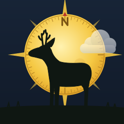

<p align="center"></p>

# revierkompass-daten

**Revierblick** (bis Version 2.0.8: Revierkompass)

Rechtsdaten (Jagdzeiten und jagdrechtliche Hinweise) und Download der App **Revierblick**.

Die App lädt die Datei über diese Adresse:

```
https://raw.githubusercontent.com/Tropper71/revierkompass-daten/main/rechtsdaten.json
```

## App herunterladen

[Revierblick-2.1.0.apk](app/Revierblick-2.1.0.apk) (Android 7.0 oder neuer)

Direkter Download: https://raw.githubusercontent.com/Tropper71/revierkompass-daten/main/app/Revierblick-2.1.0.apk

APK antippen, Installation aus dieser Quelle einmal erlauben. Updates werden einfach über die vorhandene Version installiert, alle Daten bleiben erhalten, auch beim Wechsel von Revierkompass auf Revierblick. Anleitung im Handbuch, Kapitel 2.

## Handbuch

[Revierblick-Handbuch.pdf](docs/Revierblick-Handbuch.pdf) (34 Seiten, Version 2.1.0, Stand 11.11.2026)

Direkter Download: https://raw.githubusercontent.com/Tropper71/revierkompass-daten/main/docs/Revierblick-Handbuch.pdf

## Inhalt

- `wildarten`, `gesetz`, `verordnung`: Brandenburg (BbgJagdG, BbgJagdDV, JagdZeitV)
- `laender`: übrige Bundesländer mit Qualitätsstufe
  - **A** amtlicher Text (amtliches Portal oder Gesetzblatt)
  - **B** Verordnungswortlaut aus nicht amtlicher Rechtsdatenbank
  - **C** Landesrecht nicht ausgewertet, nur Bundesrahmen
- `quellen`, `aenderungen`: Fundstellen und Änderungsprotokoll

Verlagstabellen werden nicht verwendet.

## Lizenz

CC0 1.0 Universal, siehe [LICENSE](LICENSE).

## Haftungsausschluss

Zusammenstellung nach bestem Wissen aus den im Feld `quellen` genannten Fundstellen.
Keine Rechtsberatung, keine Gewähr für Richtigkeit und Aktualität. Maßgeblich sind allein
die amtlich verkündeten Gesetze und Verordnungen sowie Allgemeinverfügungen der Jagdbehörden.
